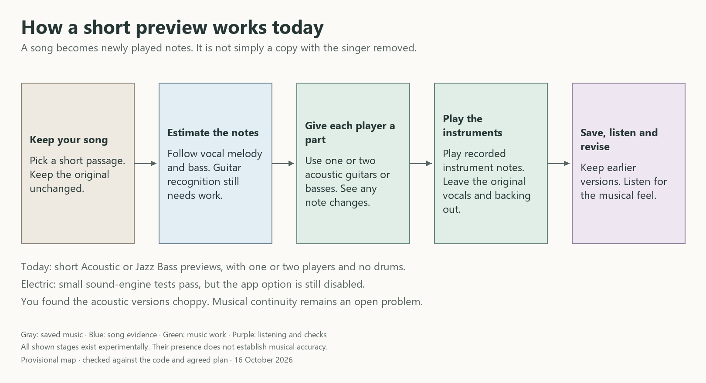
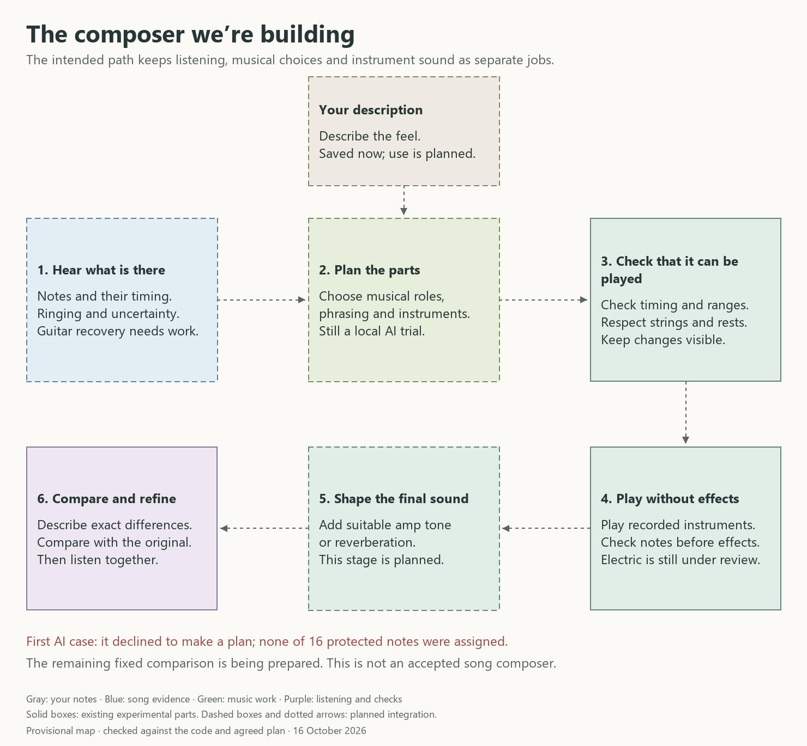

# Wood & String

I’m into guitars, and songs like Radiohead’s *Weird Fishes / Arpeggi* and Dahi’s *How To Pray* made me want to hear and study music as instrumentals and explore how those parts might translate to guitar and bass.

Wood & String is my unfinished experiment in a private, local music player that can help with that. I’m working through vocal separation, note transcription, playable arrangements and expressive rendering, with local processing and offline use as the aim.

## Where it is

The prototype stores and plays local music, makes short experimental acoustic and Jazz Bass previews, and lets me inspect candidate notes or revise a saved passage. Electric guitar, optional drums, full-song arrangements and a small local AI arranger are still being developed. This source snapshot is not a ready-to-install release.

There’s also a processing queue: save a short preview request on a device, send it when the laptop is reachable, and let it wait if the laptop is busy. Phone setup and real-device testing are still ahead.

I want three ways to arrange a song: Keep it close, Essentials and Reimagine. Essentials would keep the riff or melody I came to hear and leave the extra layers out. A synth or vocal might carry that hook in the original; translating it to guitar shouldn’t mean pretending it was a guitar all along. These choices are still being developed.

I’m also working on separate playable parts. Muting one guitarist in a duet leaves a duet with a muted part; making a complete solo version takes different musical decisions. The first software controls for aligned parts and saved mixes pass silent tests, but they aren’t connected to the player yet.

## How I’m putting it together

*The short-preview experiment, shown on 16 October 2026. The choppy earlier results are still a problem to solve.*

*The composer I’m working toward. This provisional map shows existing pieces and planned integration. Optional Electric tone has since reached backend tests, but stays disabled in the app and still needs a listening check.*

## What I’m learning

The first previews were choppy. Getting pitches into a guitar sound wasn’t enough: ringing notes, repeated attacks, rests, phrasing and the identity of the important part all matter. Following the vocal melody can miss the guitar pattern that made me interested in the song in the first place.

One useful lesson was that an engine fix left the rejected previews completely unchanged. I’m now recording what each comparison actually tells me about timing, ringing, dynamics or tone, and what still needs a listening check. Those details matter more than a single quality score.

That has shaped the engineering: keep originals intact, preserve source timing, show uncertain notes and omissions, and keep vocal removal separate from recreating a performance. A successful render or a passing test doesn’t mean the arrangement sounds right.

Next is making those musical decisions better, then returning to real-song listening comparisons. The two songs above are inspirations and planned tests, not examples I’ve already recreated successfully.

The public repository contains source and tests. Recordings, sample banks, model weights, downloaded runtimes and private development data are not included there. Original code is MIT licensed; [third-party code and notices](THIRD_PARTY.md) retain their own licenses.
